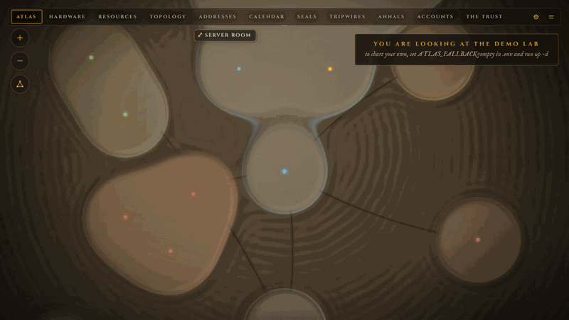
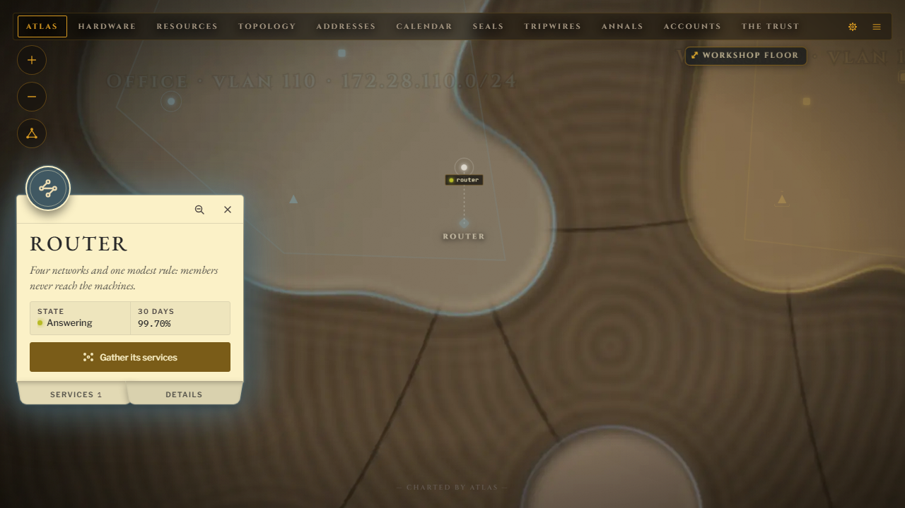
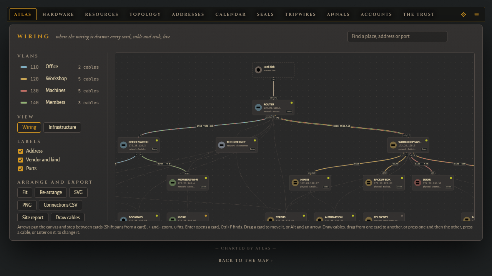
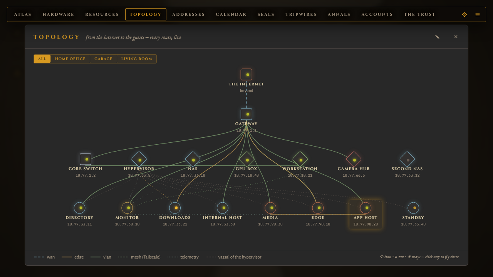
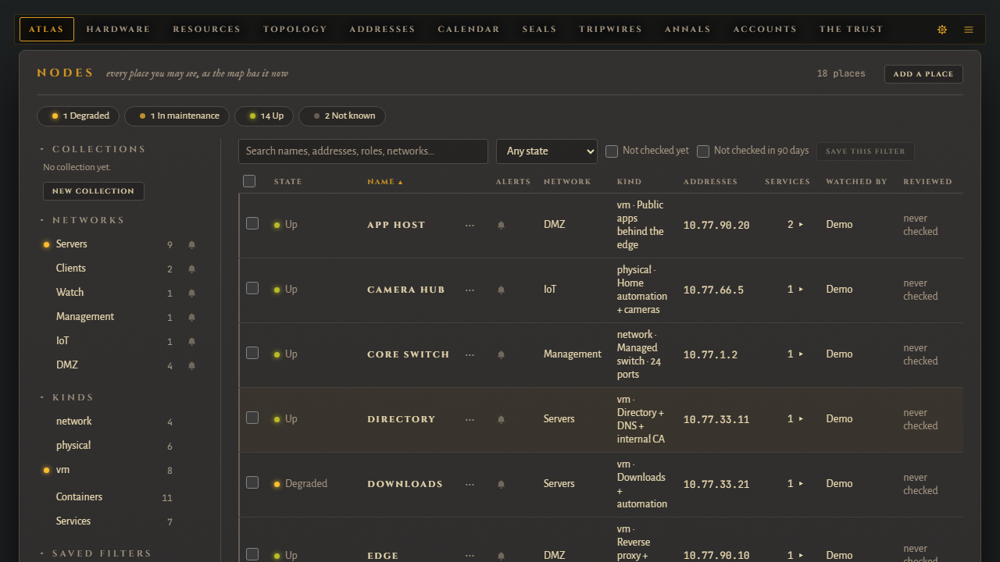
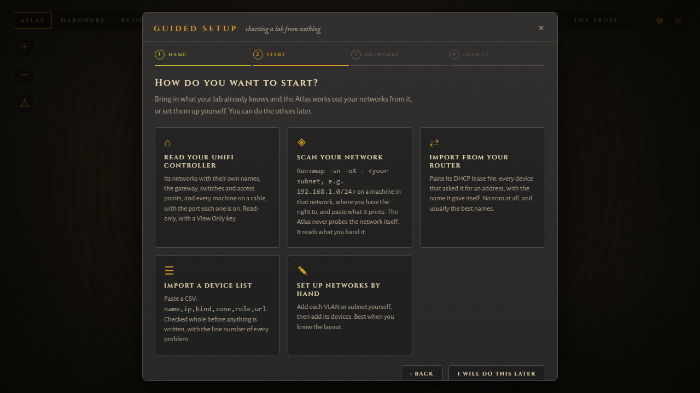
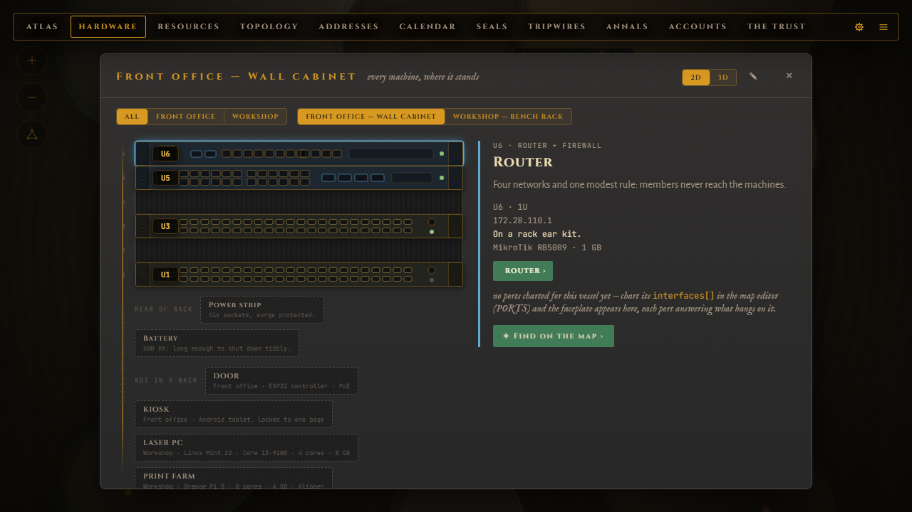
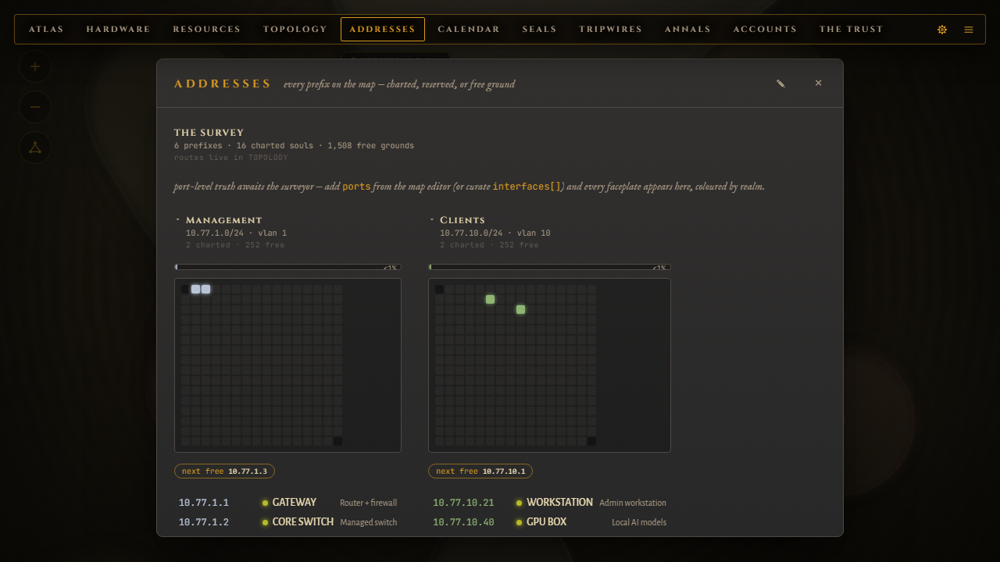
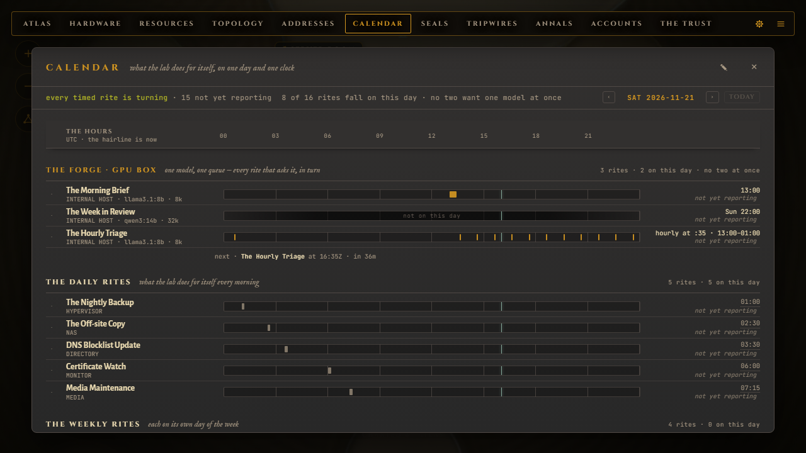
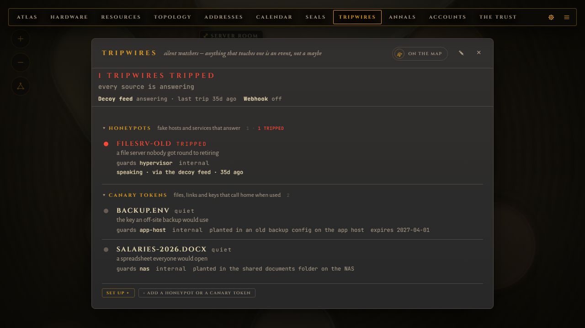

# Atlas

**A living map of your homelab.** Hosts, services, networks, racks, cables,
certificates and scheduled jobs on one illustrated map, coloured with live
health from the monitoring you already run, or from Atlas's own checks.

**[Try the live demo](https://atlas.outset.systems/demo/)** ·
[Install](docs/install.md) ·
[Configuration](docs/configuration.md) ·
[API](docs/api.md) ·
[AI agents](docs/mcp.md) ·
[outset.systems/atlas](https://outset.systems/atlas/)

[](https://github.com/Outset-Systems/atlas/tags)
[](https://github.com/Outset-Systems/atlas/actions/workflows/tests.yml)
[](LICENSE)
[](https://github.com/Outset-Systems/atlas/stargazers)



| | | |
|---|---|---|
|  **A place's card, on the map** |  **Wiring: cards, cables, ports and VLANs** |  **Topology, from the internet in** |
|  **Nodes: every place, its state and its checks** |  **Guided setup, from nothing** |  **Hardware: racks in 2D and 3D** |
|  **Addresses on real CIDR maths** |  **A calendar that notices a missed job** |  **Tripwires that light up when touched** |

Every name and address in these pictures is invented: they are the Fernhill
Workshop, the demo lab that ships with Atlas.

> **Status: v0.2, in development.** It works and is in daily use. Expect rough
> edges and breaking changes between 0.x versions. Bug reports are very
> welcome.

## Quickstart

You need Docker with Compose v2.

```sh
git clone https://github.com/outset-systems/atlas.git && cd atlas
printf 'ATLAS_ADMIN_PASSWORD=%s\n' "$(openssl rand -base64 24)" > .env
docker compose -f compose.public.yaml up -d
```

Open <http://localhost:5006> and sign in as `admin` with the password in
`.env`. A new Atlas is uncharted and offers the guided setup. To look around
the invented demo lab first, add `ATLAS_FALLBACK=bundled` to `.env` and run
the last command again.

The full guide, including TLS behind Caddy or nginx, backups and upgrades, is
[docs/install.md](docs/install.md).

## Why a map

- **A dashboard shows tiles.** Atlas shows where each thing is, what it runs
  and what it depends on, so "the gateway is down, and nine places behind it"
  reads as one problem, not ten.
- **A drawn diagram goes stale.** Atlas's markers change with what your
  monitoring reports, and it says so when a source stops answering.
- **A scanner draws whatever it finds.** Atlas never scans your network. You
  chart it once, by hand or from what your lab already knows, and it stays the
  way you meant it.

## Features

### Set up in minutes

- **Guided setup.** A new Atlas opens on four steps: name it, choose how to
  start, check the networks it found, then the devices. Start from a UniFi
  controller (read-only, with a View Only key), the output of an nmap sweep
  you ran yourself, your router's DHCP leases (ISC, dnsmasq, Kea, Windows
  Server), a CSV device list, or by hand. Atlas works out your networks from
  what you bring, and you review every row before anything is written.
- **Suggestions, not guesses.** A device from a sweep or a lease file arrives
  with a suggested type from its maker or its name, marked for you to check.
- **Edit in the browser.** The map editor has a form for every field, a box
  you draw on the map to make a room or a rack its own zoom map, and an undo
  for the last 50 changes. Every change is validated and recorded. On the `db`
  backend, NetBox and nmap importers also run from the command line.

### See the whole lab

- **One map of everything.** Places grouped into network zones, the links
  between them, and the services each one runs. Pan, zoom, search with `/`,
  and open any place for its card. Rooms and racks open as their own maps as
  you zoom in (with links straight to one, `#region=<id>`).
- **Wiring.** Every device as a card with its live state, every cable with
  the port at each end, its VLANs written as `U1 T10,20`, and PoE. An admin
  drags cards, draws, changes and removes cables, and adds stubs for what is
  not charted yet; the UniFi import offers the cables it can see. Switch to
  the infrastructure view, find a place, address or port, and export the
  drawing as SVG or PNG, the connections as CSV, or a site report for the
  printer.
- **Topology.** The network from the internet inwards, in tiers: every route
  by kind (WAN, edge, VLAN, mesh, telemetry), with a guest hanging under its
  host. Trace any hop.
- **Nodes.** Every place and service in one table, with its state, network,
  kind, addresses, who watches it and when a person last reviewed it. Filter
  by state, network or kind, save filters, group places into collections, and
  open one menu per row to check it now, ask *where does it break?* (each step
  from the gateway down), set a maintenance window or an alert.
- **Hardware, addresses and the rest.** Rack elevations in 2D and 3D, an IP
  address view built on real CIDR maths, certificate expiry, a calendar of
  scheduled jobs that notices when one did not run, and an event history.

### Know what is happening

- **Live health.** Markers follow what Uptime Kuma reports, a UniFi controller
  can say what is connected right now, and Prometheus and Loki fill the cards'
  vitals and charts. With no monitoring at all, Atlas checks the places and
  services you charted itself (HTTP, TCP, DNS, a keyword or a JSON value), each
  on its own interval: it asks only what is on the map, so it still never
  scans. A source that goes down only removes its markers; the map keeps
  working.
- **Alerts.** Per place, network or collection, to Discord, ntfy, Gotify or a
  webhook. Off until an operator turns them on.
- **Know what a person checked.** Every place records when it was charted,
  where it came from and whether a person has reviewed it. An import is a
  guess until someone checks it.
- **Tripwires.** Chart your honeypots (OpenCanary, a fake share) and canary
  tokens (a document, a URL, a cloud key), and Atlas lights the one that is
  touched, through one signed webhook. Admins only: where bait sits stays
  secret. Atlas never plants bait itself
  ([turn it on](docs/install.md#turn-on-tripwires)).

### Make it yours

- **Your own map art, and its own words.** Bring any picture as a map style
  and place your markers on it. Atlas speaks in lore (rites, realms, annals)
  or, with one setting, in standard words.
- **Light or dark panels.** ☀/☾ or `T`, following your system until you
  choose; the map itself stays a night map.

### Safe and small to run

- **Real sign-in.** Local accounts with TOTP, optional LDAPS directory
  sign-in, or single sign-on behind a reverse proxy that signs each request.
  Places can be hidden from viewers outside a group.
- **Small.** One container, one volume, no database server, no telemetry.
  Plain JavaScript, no build step. It calls only the services you point it at,
  and public whois servers when a viewer asks (`ATLAS_WHOIS=0` turns that
  off).

## For scripts and AI agents

A documented read-only API and an MCP server let a script or an AI agent ask
the map what is here, what depends on it, whether it is healthy and whether a
person has checked it, before it acts.

- **Off until you turn it on.** Every token is refused and the MCP endpoint
  answers 404 until an admin turns agent access on in Settings, Connections.
  `ATLAS_AGENT_API=0` keeps it off for good. Tokens are shown once, expire
  (90 days by default) and can be revoked.
- **Read-only, and sees less than a person.** A token cannot change the map.
  It sees no accounts, no tripwires and no places hidden for a group, and is
  not sent passwords or query strings inside a charted URL.
- **A cloud tool gets a smaller token.** A cloud token reads only places a
  person has checked, with no addresses, MAC addresses, URLs, hardware or
  notes, through the MCP endpoint only, for 30 days at most; the names of
  those places and how they connect still leave.
- **Use a local model.** Atlas never calls a model itself. With a local model
  (Ollama, LM Studio, your own harness), answers stay on your network. With a
  cloud model, everything the agent reads is sent to that model's vendor.

See [the API guide](docs/api.md) and [Atlas for AI agents](docs/mcp.md).

## Configuration

Everything is set with environment variables; most integrations can also be
changed from the Settings panel while the app runs. Every variable, its
default and what it does: [docs/configuration.md](docs/configuration.md).

## Documentation

- [Installing](docs/install.md)
- [Configuration reference](docs/configuration.md)
- [API guide](docs/api.md) and its [OpenAPI reference](docs/openapi.json)
- [Atlas for AI agents (MCP)](docs/mcp.md)
- [Architecture](docs/architecture.md), for contributors
- [Contributing](docs/CONTRIBUTING.md)
- [Code of conduct](docs/CODE_OF_CONDUCT.md)

## Security

The map describes your network, so treat access to it like access to your
network diagrams. Run it in `accounts` mode (the default in
`compose.public.yaml`) behind TLS, and give an API token only to a tool you
would show your network diagram to. Please report vulnerabilities privately
as described in [docs/SECURITY.md](docs/SECURITY.md), not in a public issue.

## License

MIT. See [LICENSE](LICENSE).
