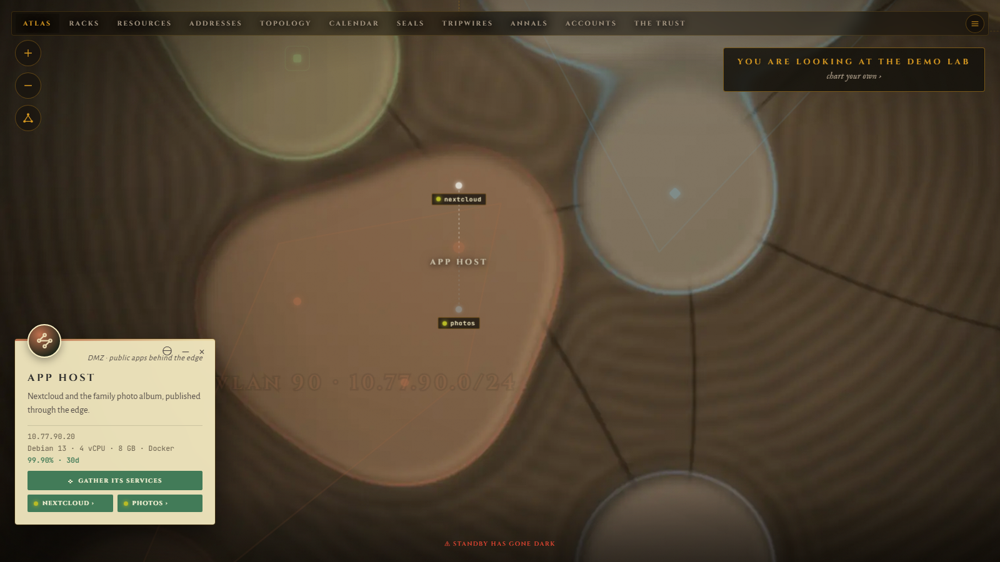

# Atlas

Atlas is a self-hosted map of your homelab. It draws your hosts, services,
networks, racks, certificates and scheduled jobs on one illustrated map, and
colours it with live health from Prometheus, Loki and Uptime Kuma.



> **Status: v0.1, early.** It works and is in daily use, but this is
> the first public release: expect rough edges, missing docs and breaking
> changes between 0.x versions. The install guide has been followed word for
> word on a clean machine. Bug reports are very welcome.

## Features

- **One map of everything.** Places grouped into network zones, the links
  between them, and the services each one runs. Pan, zoom, search with `/`,
  and open any place for its details.
- **Live health.** Markers turn with the state Prometheus, Uptime Kuma and an
  optional decoy feed report. A source that goes down only removes its
  markers; the map keeps working.
- **Views for the details:** an address ledger built on real CIDR maths, rack
  elevations in 2D and 3D, the network path from the internet inwards,
  certificate expiry, a calendar of scheduled jobs that notices when one did
  not run, and an event history.
- **Edit in the browser.** A guided first setup and forms for every field.
  Fill the map from a CSV device list, an nmap sweep or your router's DHCP
  leases (ISC, dnsmasq, Kea, Windows Server); each device arrives with a
  suggested type from its maker or its name, for you to check. The Atlas never
  scans the network itself. NetBox and nmap importers on the command line too.
  Every change is validated, recorded and can be undone.
- **Real sign-in.** Local accounts with TOTP, optional LDAPS directory
  sign-in, or single sign-on behind a reverse proxy that signs each request.
  Places can be hidden from viewers outside a group.
- **Small to run.** One container, one volume, no database server, no
  telemetry; it only calls the services you point it at. Plain JavaScript, no build
  step.

**Planned for v0.2:** NetBox integration (sync, beyond today's one-way
command-line import) and 3D views of the main map (racks already have one).

## Quickstart

You need Docker with Compose v2.

```sh
git clone https://github.com/outset-systems/atlas.git && cd atlas
printf 'ATLAS_ADMIN_PASSWORD=%s\n' "$(openssl rand -base64 24)" > .env
docker compose -f compose.public.yaml up -d
```

Open <http://localhost:5006> and sign in as `admin` with the password in
`.env`. To look around the invented demo lab first, add
`ATLAS_FALLBACK=bundled` to `.env` and run the last command again.

The full guide, including TLS behind Caddy or nginx, backups and upgrades, is
[docs/install.md](docs/install.md).

## Configuration

Everything is set with environment variables; most integrations can also be
changed from the Settings panel while the app runs. Every variable, its
default and what it does: [docs/configuration.md](docs/configuration.md).

## Documentation

- [Installing](docs/install.md)
- [Configuration reference](docs/configuration.md)
- [Architecture](docs/architecture.md), for contributors
- [Contributing](docs/CONTRIBUTING.md)
- [Code of conduct](docs/CODE_OF_CONDUCT.md)

## Security

The map describes your network, so treat access to it like access to your
network diagrams. Run it in `accounts` mode (the default in
`compose.public.yaml`) behind TLS. Please report vulnerabilities privately as
described in [docs/SECURITY.md](docs/SECURITY.md), not in a public issue.

## License

MIT. See [LICENSE](LICENSE).
