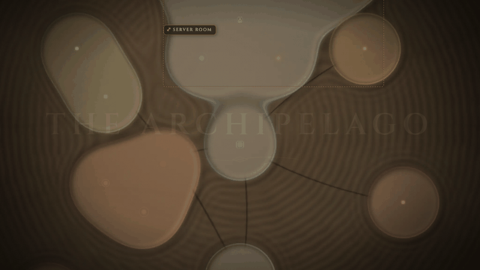
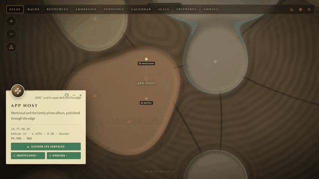
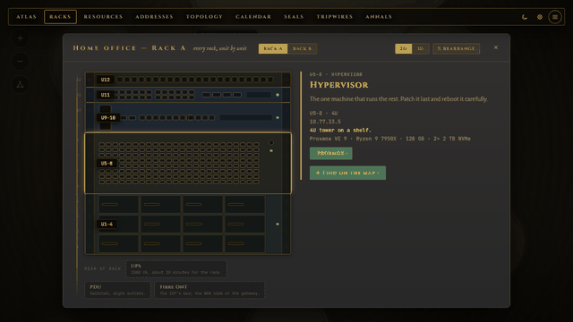
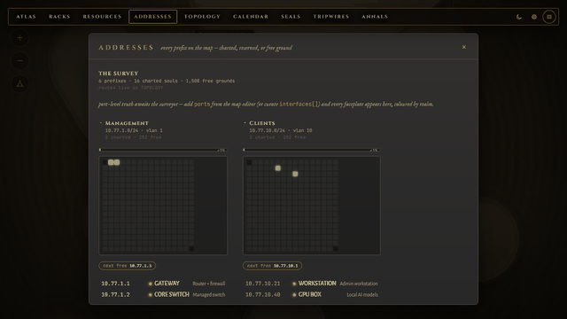
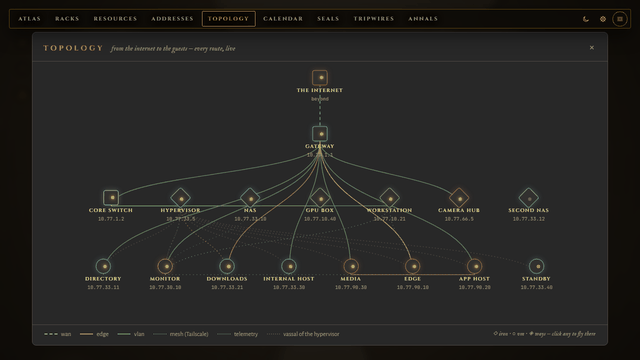
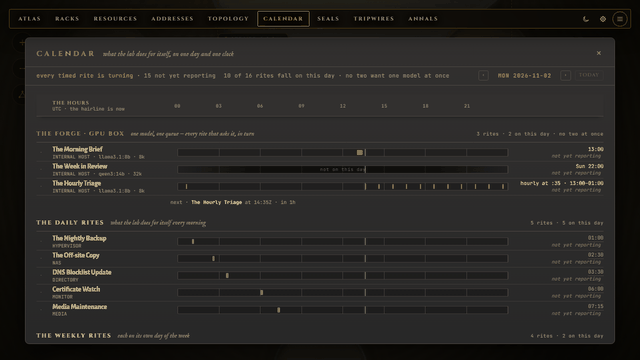
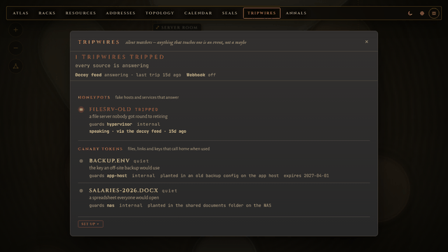

# Atlas

**A living map of your homelab.** Hosts, services, networks, racks,
certificates and scheduled jobs on one illustrated map, coloured with live
health from the monitoring you already run: Uptime Kuma for the markers,
Prometheus and Loki for the numbers.

**[Try the live demo](https://atlas.outset.systems/demo/)** ·
[Install](docs/install.md) ·
[Configuration](docs/configuration.md) ·
[API](docs/api.md) ·
[AI agents](docs/mcp.md) ·
[outset.systems/atlas](https://outset.systems/atlas/)

[](https://github.com/Outset-Systems/atlas/releases)
[](https://github.com/Outset-Systems/atlas/actions/workflows/tests.yml)
[](LICENSE)
[](https://github.com/Outset-Systems/atlas/stargazers)



| | | |
|---|---|---|
|  **A place's card** |  **Racks, in 2D and 3D** |  **Addresses on real CIDR maths** |
|  **Topology, from the internet in** |  **A calendar that notices a missed job** |  **Tripwires that light up when touched** |

Every name and address in these pictures is invented.

## Why a map

- **A dashboard shows tiles.** Atlas shows where each thing is, what it runs
  and what it depends on, so "the gateway is down, and nine places behind it"
  reads as one problem, not ten.
- **A drawn diagram goes stale.** Atlas's markers change with what your
  monitoring reports, and it says so when a source stops answering.
- **A scanner draws whatever it finds.** Atlas never scans your network. You
  chart it once, by hand or from a UniFi controller, an nmap sweep, a CSV or
  your router's DHCP leases, and it stays the way you meant it.

> **Status: v0.2, in development.** It works and is in daily use. The first
> public builds were the v0.1 release candidates; the `v0.2.0-dev.*` tags add
> the API, the MCP server, provenance and UniFi. Expect rough edges and
> breaking changes between 0.x versions. Bug reports are very welcome.

## Features

- **One map of everything.** Places grouped into network zones, the links
  between them, and the services each one runs. Pan, zoom, search with `/`,
  and open any place for its details.
- **Live health.** Markers turn with the state Uptime Kuma reports, and a UniFi
  controller can report what is connected right now. With no monitoring at
  all, Atlas can check the service URLs you charted itself: it asks only what
  is on the map, so it still never scans. Prometheus and Loki fill
  the place cards' vitals and charts. A source that goes down only removes its
  markers; the map keeps working.
- **Know what a person checked.** Every place records when it was charted,
  where it came from (by hand or an import) and whether a person has reviewed
  it. An import is a guess until someone checks it, and the Desk lists what is
  still unchecked.
- **Tripwires.** Chart your honeypots (OpenCanary, a fake share) and canary
  tokens (a document, a URL, a cloud key), and the Atlas lights the one that
  is touched. Trips arrive through one signed webhook that OpenCanary,
  Canarytokens or any script can call, and the scene says so out loud when a
  feed stops answering or a webhook has never been reached. Admins only: where
  bait sits stays secret. The Atlas never plants bait itself
  ([turn it on](docs/install.md#turn-on-tripwires)).
- **Views for the details:** an IP address view built on real CIDR maths, rack
  elevations in 2D and 3D, the network topology from the internet inwards,
  certificate expiry, a calendar of scheduled jobs that notices when one did
  not run, an event history, and detailed maps for a room or a rack that open
  as you zoom in (with links straight to one, `#region=<id>`). A region can
  fold, so its parent map shows only the places that talk outside it.
- **Light or dark panels.** ☀/☾ or `T`, following your system until you choose;
  the map itself stays a night map.
- **Your own map art, and its own words.** Bring any picture as a map style and
  place your markers on it. The Atlas speaks in lore (rites, realms, annals) or,
  with one setting, in standard words, and a style can bring words of its own.
- **Edit in the browser.** A guided first setup and forms for every field.
  Fill the map from a UniFi controller (its networks, gear, ports, MAC
  addresses, SSIDs, a power strip's outlets and the machines on them, in one
  import you review row by row), a CSV device list, an nmap sweep or your
  router's DHCP leases (ISC, dnsmasq, Kea, Windows Server). A sweep or leases device arrives
  with a suggested type from its maker or its name, for you to check; a CSV
  row takes the type you gave it, `physical` if you gave none. The Atlas never
  scans the network itself. On the `db` backend, NetBox and nmap importers on
  the command line too.
  Every change to the map is validated and recorded, and the last 50 can be
  undone. Moved markers and rearranged racks are saved apart, with no undo.
- **Real sign-in.** Local accounts with TOTP, optional LDAPS directory
  sign-in, or single sign-on behind a reverse proxy that signs each request.
  Places can be hidden from viewers outside a group.
- **Small to run.** One container, one volume, no database server, no
  telemetry. It calls the services you point it at, and public whois servers
  when a viewer asks, which is on by default (`ATLAS_WHOIS=0` turns it off).
  Plain JavaScript, no build step.

## For scripts and AI agents

New in v0.2: a documented read-only API and an MCP server. A script or an AI
agent can ask the map what is here, what depends on it, whether it is healthy
and whether a person has checked it, before it acts.

- **Read-only.** A token cannot change the map, and nothing in Atlas touches
  your network.
- **Sees less than a person.** A token sees no more than a signed-in viewer
  with no groups: no accounts, no tripwires and no places hidden for a group.
  It is also not sent the password or query string inside a charted URL, what a
  scheduled job wrote about its own run, or who acknowledged an event.
  Everything else on the map, addresses included, it can read.
- **Use a local model.** Atlas never calls a model itself. With a local model
  (Ollama, LM Studio, your own harness), answers stay on your network. With a
  cloud model, everything the agent reads is sent to that model's vendor.
- **A cloud tool gets a smaller token.** Atlas cannot tell where a client sends
  what it reads, so you say what a token is for when you create it. A cloud
  token reads only places a person has checked, with no addresses, MAC
  addresses, URLs, hardware or notes, through the MCP endpoint only, for 30
  days at most. The names of those places and how they connect still leave.
- **Off until you turn it on.** On a new Atlas every token is refused and the
  MCP endpoint answers 404, until an admin turns agent access on in Settings,
  Connections. `ATLAS_AGENT_API=0` keeps it off for good. Each token is shown
  once, expires (90 days by default), and can be revoked at any time.

See [the API guide](docs/api.md) and [Atlas for AI agents](docs/mcp.md).

## Quickstart

You need Docker with Compose v2.

```sh
git clone https://github.com/outset-systems/atlas.git && cd atlas
printf 'ATLAS_ADMIN_PASSWORD=%s\n' "$(openssl rand -base64 24)" > .env
docker compose -f compose.public.yaml up -d
```

Open <http://localhost:5006> and sign in as `admin` with the password in
`.env`. To look around the invented demo lab first, add
`ATLAS_FALLBACK=bundled` to `.env` and run the last command again.

The full guide, including TLS behind Caddy or nginx, backups and upgrades, is
[docs/install.md](docs/install.md).

## Configuration

Everything is set with environment variables; most integrations can also be
changed from the Settings panel while the app runs. Every variable, its
default and what it does: [docs/configuration.md](docs/configuration.md).

## Documentation

- [Installing](docs/install.md)
- [Configuration reference](docs/configuration.md)
- [API guide](docs/api.md) and its [OpenAPI reference](docs/openapi.json)
- [Atlas for AI agents (MCP)](docs/mcp.md)
- [Architecture](docs/architecture.md), for contributors
- [Contributing](docs/CONTRIBUTING.md)
- [Code of conduct](docs/CODE_OF_CONDUCT.md)

## Security

The map describes your network, so treat access to it like access to your
network diagrams. Run it in `accounts` mode (the default in
`compose.public.yaml`) behind TLS. An API token reads the map, so give one
only to a tool you would show your network diagram to. Please report vulnerabilities privately as
described in [docs/SECURITY.md](docs/SECURITY.md), not in a public issue.

## License

MIT. See [LICENSE](LICENSE).
