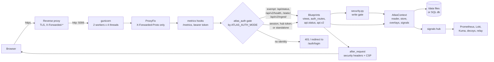
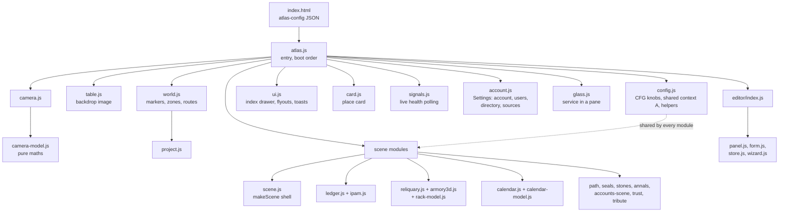

# Architecture

This page is for contributors. It describes the code as it is, file by file,
so you can find where a change belongs. User-facing setup is in
[install.md](install.md); every setting is in
[configuration.md](configuration.md).

The Atlas is a Flask 3 app served by gunicorn, plus a front end of plain
JavaScript modules with no build step. It keeps its state in files under
`/data` (or, optionally, a SQL database) and reads live health from
Prometheus, Loki, Uptime Kuma and a decoy feed when they are configured.

A note on the version numbers in comments: the Atlas ran for a year as one
lab's private tool before this public release, and comments that explain why
code is the way it is cite that tool's own releases (`v1.38.0`, `v1.49.0`).
They are history, not the public version line, which starts at 0.1.

```
Web/                  the app (this is what the image runs)
  app.py              the app factory, create_app()
  settings.py         environment variables, read in one place
  envnames.py         the one reader for renamed settings
  api/status.py       /api/status and /api/manifest
  api/v2/             the HTTP API, one blueprint at /api/v2/
  views.py            the map page, map images, staged reports
  auth_routes.py      the sign-in page and the first-admin bootstrap
  atlas_auth.py       the auth gate for all four modes
  hub_auth/           signed hub identity (HMAC tokens), standalone defaults
  accounts.py         local accounts, TOTP, throttle, audit (SQLite)
  ldap_backend.py     LDAPS sign-in
  security.py         the write gate (same-origin proof + admin check)
  redaction.py        per-viewer filtering of the dataset
  labdata.py          the read path (cached, validated, hot-reloaded)
  dataset.py          the write path (typed ops, strict validation, revisions)
  overlays.py         positions.json and rack.json merged over the dataset
  schema.py           the field catalogue: what the dataset is
  validation.py       the catalogue applied to a dataset
  store/              SQLAlchemy models for the db backend
  migrations/         Alembic migrations for the db backend
  signals.py          live-health adapters and the signals hub
  integrations.py     Sources/Realm settings saved from the Settings screen
  auth_config.py      Directory settings saved from the Settings screen
  crypto_at_rest.py   the master key and Fernet encryption
  theme.py, themes/   the words and emblems that describe one lab
  templates/          index.html (the map), login.html
  static/             CSS, fonts, icons, map art, JavaScript modules
  cli.py              atlasctl: imports, exports, accounts, relay tokens
  importers/          NetBox, nmap and CSV importers
  tests/              pytest suite and node tests
relay/                optional push agent that runs on another machine
demo-lab/             the invented demo lab and its builder
```

## The request path



1. **gunicorn** runs `app:app` with two workers and four threads each
   (the Dockerfile's `public` stage sets this). `gunicorn.conf.py` starts the background
   poller in each worker and tells prometheus_client when a worker exits.
2. **ProxyFix** trusts `X-Forwarded-Proto` only, so `request.host_url`
   knows the browser is on https. It deliberately does not rewrite the client
   address; that is `atlas_auth.client_ip()`, which believes
   `X-Forwarded-For` only from the proxies named in `ATLAS_TRUSTED_PROXIES`.
3. **metrics.py** wraps every request to count it, and serves `/metrics` to
   a bearer token (404 without one).
4. **The gate**, `atlas_auth.require_atlas_auth`, runs before every request.
   A short list of exact paths and prefixes is exempt (health, status,
   manifest, static files, the relay ingest prefix which checks its own
   token). Everything else needs an identity for the configured mode, see
   [Auth modes and the gate](#auth-modes-and-the-gate).
5. **Blueprints** answer. Every write route also passes `security.py`.
6. **after_request** in `app.py` adds `X-Content-Type-Options`,
   `X-Frame-Options: DENY`, `Referrer-Policy`, `Cache-Control` for HTML, and
   the Content Security Policy.

## The app factory

`app.py` builds the app in `create_app()` and exposes `app = create_app()`
for gunicorn. Configuration is read from `settings.py`, which collects nearly
every environment variable in one module. Values are constants resolved at
import, except a few functions that read live because a test or the Settings
screen changes them at runtime (`auth_mode()`, `mfa_required()`,
`beat_token()`, `embed_hosts()` and friends).

`create_app()` does, in order:

1. Builds the **reader** (`labdata.build`) and **store**
   (`dataset.build_store`) for the configured backend, the two **overlays**,
   and the **signals hub**, and hangs them on
   `app.extensions["atlas"]` as an `AtlasContext` (`context.py`). Routes reach
   them with `context.atlas()`, never module globals, which is what lets the
   test suite build several apps with different settings in one process.
2. Configures sessions if the mode has them (`accounts`, `hybrid`): the
   signing key (env, file, or generated once into `/data/secrets/`), cookie
   name `atlas_session`, `SameSite=Lax`, `HttpOnly`, `Secure` unless
   `ATLAS_INSECURE_COOKIES=1`.
3. Registers metrics, then the gate, then the sign-in blueprint (sessions
   only) and runs the first-admin bootstrap, then `views`, `api.status` and
   the v2 API.
4. Installs the template context (theme, brand, version) and the security
   headers.
5. Logs a security warning if it is running in `standalone` mode without
   `ATLAS_ALLOW_INSECURE=1`.

Logging uses a logger tree, `atlas.<layer>.<module>` (`atlas.web`,
`atlas.api`, `atlas.auth`, `atlas.data`, `atlas.io`, `atlas.live`), so
`ATLAS_LOG_LEVELS` can turn up one layer. `tests/test_logging_tree.py` holds
the convention.

## The v2 API

`api/v2/__init__.py` defines one blueprint at `/api/v2/` and imports a module
per surface, each attaching routes to it:

| Module | Routes |
|---|---|
| `health.py` | `/health` (anonymous; same payload as `/api/status`) |
| `reads.py` | `/lab-data` (the dataset as this viewer may see it), `/maps` |
| `writes.py` | `/positions`, `/rack` (layout overlays) |
| `feeds.py` | `/signals`, `/rites`, `/events` |
| `probes.py` | `/embeddable` (may this URL be framed?), `/whois` |
| `beat.py` | `/rites/<key>/beat` (a job reports that it ran) |
| `admin.py` | `/admin/*`: the editor's ops, revisions and revert, discovery, maintenance, CSV import, map images, Directory and Sources settings, the read-only Deployment view |
| `accounts_v2.py` | `/auth/*`: sign-in, MFA, password, users, audit (sessions only) |
| `sites.py` | `/sites/*` (db backend only) |
| `ingest_v2.py` | `/ingest/{signals,inventory,observed}` (db backend and `ATLAS_INGEST_ENABLED=1`) |
| `tripwires.py` | `/ingest/tripwires` (the tripwires webhook, either backend, `ATLAS_TRIPWIRES_WEBHOOK=1`), `/tripwires` and `/tripwires/setup` (admin) |
| `vitals.py`, `charts.py` | card vitals and charts from Prometheus and Loki |
| `manifest.py` | `/manifest`, `/calendar` |
| `trust.py` | `/trust` (an admin-only proxy-trust view generated at build; answers 503 until a `Web/trust.json` is built into the image) |
| `auth.py`, `schemas.py` | not routes: the authorisation adapter and the pydantic bodies |

Two rules hold across the API:

- **The URL map is the same in every mode.** A surface that only exists in
  some configurations (sites, ingest, accounts) answers 404 per request
  rather than being left unregistered. `tests/test_api_v2_health.py`
  asserts over the URL map.
- **v2 adds no gate of its own.** Authentication is the app-wide gate;
  authorisation goes through `api/v2/auth.py`, an adapter over
  `security.py`, `redaction.py` and `atlas_auth.py`. `EXEMPT_PATHS` is the
  single list of anonymous v2 paths and is a tuple of literals on purpose,
  so adding one shows up in review.

The unversioned v1 routes are gone; `/api/status` and `/api/manifest` are the
only API paths outside `/api/v2/`.

## The data layer

### The dataset

The map is one document: `meta`, `zones`, `nodes`, `routes`, and further
collections for services, racks, prefixes, scheduled jobs (`rites`),
certificates and so on. `schema.py` is the field catalogue that defines it.
The same catalogue drives `validation.py` and the editor forms in the
browser (`static/js/editor/form.js`), so adding a field is one change.

**Read path, `labdata.py`.** `FileLabData` reads `ATLAS_DATA`, caches it,
re-reads when the file's mtime changes, and validates in **warning** mode: a
hand-edited file renders as much as it can, logs each problem, reports the
count in `X-Atlas-Data-Problems`, and marks `/api/status` unhealthy. With no
file it serves the fallback (`ATLAS_FALLBACK`): an empty, valid dataset or the
one bundled in the image. `DbLabData` answers the same
`get() -> (data, mtime, problems)` contract from the database.

**Write path, `dataset.py`.** Every edit is a list of typed operations
(`upsert`, `insert`, `delete`, `move`, `set`), never a whole document. The
store applies them to a copy, validates the result in **strict** mode and
refuses the write whole if it would add problems. It checks the client's
version to refuse a write made against a stale copy (`ConflictError`), takes
a file lock (`filelock.py`), writes atomically (`jsonio.write_json_atomic`),
snapshots the previous document into `revisions/`, and appends the change to a
journal. `revisions()` and `revert()` are the change log and undo. The ops
engine mutates a plain dict, so file and db backends cannot disagree about
what an edit means.

**Overlays, `overlays.py`.** `positions.json` (marker positions) and
`rack.json` (rack slots) are per-deployment layout, kept outside the dataset
and merged over it at serve time. The overlay wins; when the editor writes a
place's position it clears the overlay entry so the edit is not undone.

**Redaction, `redaction.py`.** Any node or service link with
`require_group` is visible only to viewers in that group. The dataset is
filtered per viewer before it is served, and responses vary on the viewer.

### The db backend

`ATLAS_DATA_BACKEND=db` stores the same dataset in SQLAlchemy models
(`store/models.py`: sites, zones, nodes and the rest), so one instance can
hold several sites and accept pushes from relay agents. Schema changes are
Alembic migrations in `migrations/versions/`. `cli.py import-json` and
`export` move a dataset between the two backends, and a round-trip test
guards that export renders exactly like the file it came from.

### Other files under `/data`

`events.py` (event history), `heartbeats.py` (scheduled-job beats and the
drop directory), `maintenance.py` (planned windows), `discovery.py` and
`importers/` (scans and imports, recorded as observations for drift),
`mapart.py` (uploaded map images), `accounts.py` (`accounts.db`),
`integrations.py` and `auth_config.py` (settings saved from the UI), and
`crypto_at_rest.py` (the master key under `secrets/`).

## Auth modes and the gate

`ATLAS_AUTH_MODE` is read live through `settings.auth_mode()`.

| Mode | What the gate accepts |
|---|---|
| `standalone` | Everything. The viewer is `ATLAS_STANDALONE_USER` and sees everything. Writes are refused unless `ATLAS_ALLOW_INSECURE=1`. |
| `hub` | A valid signed token in the `ATLAS_HUB_AUTH_HEADER` header (`hub_auth/auth.py`, HMAC-SHA256 with `ATLAS_HUB_SECRET`, short expiry). Without a secret: the plaintext `X-Remote-User` header (legacy; only safe when nothing else can reach the port). No sign-in page. |
| `accounts` | A Flask session for an account that still exists, is active, carries the account's current session epoch (bumped on password change), is inside the idle and absolute lifetimes, and is not halfway through MFA. Otherwise 401 for the API and a redirect to `/auth/login` for pages. |
| `hybrid` | A verified hub token if present, else an `accounts` session. Unsigned `X-Remote-*` headers are never accepted here; without `ATLAS_HUB_SECRET` the hub path is off and everyone uses the sign-in page. |

Sign-in (`api/v2/accounts_v2.py`) tries the backends in
`ATLAS_AUTH_BACKENDS` order: `accounts.py` checks a PBKDF2 hash, and
`ldap_backend.py` binds to the directory as the user over LDAPS and mirrors
the identity into `accounts.db`. A throttle limits failures per user and per
client IP. TOTP secrets are encrypted with the master key; the MFA policy is
`ATLAS_MFA_REQUIRED`.

**Admin** means: in `accounts`, the account's admin flag (or membership of
`ATLAS_LDAP_ADMIN_GROUPS` for directory users); with a hub identity,
membership of `ATLAS_ADMIN_GROUP`.

**Writes** pass `security.py`, which needs both a same-origin proof (the
custom header `X-Atlas-Write`, which a cross-origin page cannot send without a
CORS preflight the app never answers, plus a `Sec-Fetch-Site` that is not
cross-site) and the admin check. A read-only instance (`ATLAS_READONLY`)
refuses every write regardless. Machine routes (the beat, ingest) carry their
own token checks instead.

## Signals and sources

`signals.py` has one small adapter per source: `PrometheusAdapter`,
`KumaAdapter` (Kuma's `/metrics`), `DeceptionAdapter` (the decoy feed),
`RelayAdapter` (the latest push stored by ingest) and `StaticFileAdapter`.
Each has a hard three-second timeout and **never raises**: any failure is
"no signal", so a dead source removes its markers and nothing else.
`SignalsHub` merges the enabled adapters into one feed cached for 30 seconds,
served at `/api/v2/signals`.

Which adapters exist is decided by `integrations.py`: the Settings screen's
saved values first, the environment second. The hub watches the settings
file's mtime and rebuilds its adapters when it changes, which is how a save in
one gunicorn worker reaches the other without a restart.

**Tripwires.** `tripwires.py` is the other half of the decoy story: honeypots
and canary tokens charted in `stones[]`, and trips arriving from any tool
through `POST /api/v2/ingest/tripwires` (OpenCanary, Canarytokens or a generic
`{tripwire_id, at, kind}`). The webhook shares the ingest prefix's gate
exemption but not its db requirement: a trip is matched to a stone, rebuilt
from an allow-list of short, cleaned fields (nothing the sender wrote is kept
verbatim), and appended to the event history as a `kind: tripwire` event,
coalesced while a storm lasts. `tripwires.json` beside it keeps when each
sender was last heard. `GET /api/v2/tripwires` merges those events with the
decoy feed's live `stones` into one admin-only read model; `redaction.py` and
`feeds.py` strip stones, trip events and the decoy source from every other
viewer.

`annalist.py` polls the feed in the background (every `ATLAS_ANNALS_POLL`
seconds) so the event history and missed-job checks advance even when nobody
has the map open. `events.py` records only state transitions, and
`dependencies.py` works out which places are unreachable because something in
front of them is down.

## The front end

There is no bundler and no framework. `templates/index.html` loads one ES
module, `static/js/atlas.js`, which imports the rest. Server values reach the
page as a JSON data block (`<script type="application/json"
id="atlas-config">`), which `config.js` parses.



- **`config.js` is the shared context.** It exports `CFG` (every tuning knob
  plus the server's values: auth state, theme, version) and `A`, an object
  modules attach their public functions to (`A.buildWorld`, `A.openCard`,
  `A.refreshData` …). Modules call each other through `A`, not through
  imports, so load order is the only coupling and a missing module degrades to
  a no-op (`A.buildX?.()`). `tools/check-boot.mjs` checks that every function
  the boot sequence calls is defined somewhere.
- **Scenes** are full-screen views over the map (the address ledger, the
  rack, the calendar, certificates, decoys, the event history, the network
  path, accounts). `scene.js` provides `makeScene({ id, closeId, build,
  onClose })` so each module supplies only what it draws.
- **Pure models** (`camera-model.js`, `calendar-model.js`, `ipam.js`,
  `project.js`, `rack-model.js`) have no DOM access and are unit tested with
  node.
- **The editor** (`editor/`) is inert unless the server rendered the page as
  editable. Every form submit is one atomic ops write, then the map redraws
  from the server's answer. `wizard.js` is the first-run setup.
- **Vendored libraries** live in `static/js/vendor/` (Chart.js, three.js and
  OrbitControls, and a calendar component), with their licences. Nothing is
  loaded from a CDN.
- All fetches use **relative** paths (`api/v2/...`), so the app does not need
  to know where it is mounted.

## The Content Security Policy

Every response carries:

```
default-src 'self'; style-src 'self' 'unsafe-inline'; img-src 'self' data:;
frame-src <computed>
```

There is **no inline script** and no `'unsafe-inline'` for scripts. Page data
travels in `type="application/json"` blocks, which browsers do not execute,
and all code is in files under `static/`. The sign-in page's script was moved
out of the template into `static/js/login.js` for this reason. If you add
behaviour, add it to a module; an inline `<script>` or `onclick=` attribute
will simply not run.

`style-src` allows inline styles because the JavaScript sets element styles
directly. `frame-src` is computed: `'self'`, the origins in
`ATLAS_EMBED_HOSTS`, and (with `ATLAS_EMBED_SERVICES=1`) the origins your
dataset links to, so the viewing glass can frame them. Because that list
describes your network, viewers who are not signed in get `frame-src 'self'`.
The value is memoised on the dataset's mtime.

## The theme layer

Everything that names a particular lab (the app's name, the map image, the
wording of a few labels, per-place logos, which zones start folded) lives in
`Web/themes/<name>.json`, chosen by `ATLAS_THEME`. `theme.py` loads the
chosen theme merged over `plain.json`, so a theme lists only the keys it
changes and a key added to `plain.json` can never leave another theme with a
gap. Templates read `theme.T`; the browser gets `theme.client()` as
`CFG.THEME`. The public build ships only `plain`.

## Tests

```
Web/tests/
  conftest.py        fixtures, the private_only marker
  appfixture.py      fresh_app(): a new app with given env, module reloads
  parity.py          helpers shared by the API parity tests
  fixtures/          CSV, NetBox and nmap inputs for the importers
  test_*.py          pytest
  test_*.mjs         node:test, for the pure front-end models
```

- `appfixture.fresh_app(**env)` sets environment variables, reloads the
  modules that read them at import (`settings` and friends) and returns a new
  app and test client. Use it rather than setting `os.environ` and importing
  `app`.
- Tests marked `@pytest.mark.private_only` need files that only exist in the
  original deployment and are skipped in the public tree.
- `pytest.ini` puts pytest's temporary directory beside the suite
  (`.pytest-tmp`) so runs behave the same on locked-down machines.

Run them with:

```sh
cd Web && python -m pytest -q
node --test Web/tests/*.mjs
node tools/check-boot.mjs Web/static/js
```
